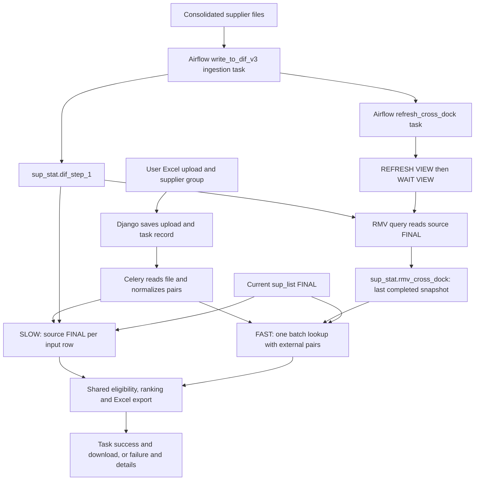

# Cross-dock FAST: technical plan and implementation record

Date: 2026-11-02. Scope: the work discussed from the initial cross-dock investigation through the
ОПТ-2 dropdown default. This document combines the agreed plan, implemented behavior, validation evidence,
and remaining rollout checks. It does not imply that every local change has been deployed.

## 1. Purpose and status

Make admin2's FAST cross-dock report select the same supplier offers as its SLOW report, using a periodically
rebuilt ClickHouse snapshot to avoid repeatedly querying the historical source for every uploaded row.
First establish SLOW's business rules against parser, then replace the old incremental MV design.

The implementation is complete locally. The user confirmed initial snapshot/source comparisons with zero
differences and successful Airflow ingestion and refresh tasks. A subsequent production report exposed a large
SQL query problem; external-data transport now fixes that locally and has passed ClickHouse 24.10 integration
tests. Final production revalidation of that fix, representative performance measurements, and retirement of
the old MV objects remain separate acceptance steps.

The older documents in `docs/cross_dock/mv-implementation-*.md` describe the initial incremental MV proposal.
They are historical context, not the final architecture. In particular, optional automatic fallback to SLOW
in those documents is not current behavior: query errors fail the task visibly.

## 2. Original problems and investigation

The initial symptom was an Excel upload followed by clicking **Fast Supplier Query (MV)** and a redirect to the
task list without an apparent new task. Investigation needed to follow the complete submission and execution
path rather than infer success from the redirect. The current upload handler can redirect after errors, so a
redirect by itself is not evidence that a task was created or processed.

The user supplied definitions for four ClickHouse objects:

| Object | Original role and relevant definition |
| --- | --- |
| `sup_stat.dif_step_1` | Source offers: `dateupd Date`, `supid Int32`, `b String`, `a String`, `p Float64`, `q Int32`. `ReplacingMergeTree`, daily partitions, replacement key `(dateupd, supid, b, a)`, 15-month TTL. |
| `sup_stat.sup_list` | Supplier metadata: `dif_id`, `skl`, `name`, `post`, `lists Array(String)`. `ReplacingMergeTree ORDER BY dif_id`. `post` is delivery time in hours. |
| `sup_stat.mv_cross_dock` | Old target with supplier name/list, lowercase brand/SKU, price, quantity, date. `ReplacingMergeTree(update_date)` ordered by `(supplier_list, brand_lower, sku_lower, supplier_name, price, quantity)`, five-day TTL. |
| `sup_stat.mv_cross_dock_view` | Incremental insert-triggered view. Joined source to supplier metadata, expanded `sl.lists` with `ARRAY JOIN`, lowercased identifiers, kept positive stock and five days of offers. |

The ingestion code was inspected in `airflow/dags/write_to_dif.py`. Its non-partner branch inserts prepared
consolidated data into `sup_stat.dif_step_1`; the partner branch writes `sup_stat.dif_partners` instead.
The inspected source-writing function uses inserts, not a routine source-table mutation/rebuild.
That does not rule out other writers or administrative mutations outside this DAG.

### Why the original incremental MV could disagree with SLOW

1. **Different replacement identities.** The source replaces rows with the same date, supplier ID, brand,
   and SKU. The old target included price and quantity in its replacement key. A changed price or stock level
   therefore created a different target key instead of replacing the previous offer.
2. **Source consolidation was not replayed.** An incremental MV transformed newly inserted blocks. Later
   source merges or mutations did not recompute the already materialized target from the resolved source.
3. **Zero-stock updates could leave stale positive offers.** The old view filtered `q > 0` before storing data.
   A same-day replacement setting stock to zero did not remove a previously materialized positive row.
4. **Supplier metadata was copied too early.** Supplier name and group membership were captured during
   insertion. A later rename or list-membership change could leave old materialized rows inconsistent with
   current metadata. The user confirmed that different supplier IDs do not share a name; this does not solve
   metadata becoming stale over time.
5. **List expansion duplicated stored offers.** One offer was stored for each supplier list. This increased
   dependence on metadata state and was unnecessary for a reusable offer snapshot.
6. **Input brand normalization was incomplete.** Hyundai/Kia aliases were an example of a shared dictionary
   problem, not a reason to maintain an independent hardcoded FAST rule.
7. **Unresolved source replacements and ties affected reproducibility.** SLOW/parser needed `FINAL` and
   explicit ordering rules before serving as the reference for FAST comparisons.
8. **Driver and error-handling problems obscured failures.** Cross-dock needed the `clickhouse_connect`
   `.query(...).result_rows` interface and propagation of query/export failures to the background task.

## 3. Agreed sequence and delivered changes

| Phase | Work and decision | State/evidence |
| --- | --- | --- |
| 1 | Align admin2 SLOW with parser's Cross-doc selection and Excel output. | Implemented before redesigning FAST; commit `b0f55d7`. |
| 2 | Upgrade project dependencies, Python, Django, uv-based Docker build. | Implemented; user confirmed server rebuild worked; commit `53a6ecf`. |
| 3 | Fix ClickHouse driver API and exception propagation; improve login/logout UI. | Implemented; driver correction recorded in `6453b73`; user accepted logout styling. |
| 4 | Replace incremental-MV proposal with a refreshable snapshot and migration SQL. | Implemented; permanent `rmv_cross_dock` names agreed; initial DB comparison confirmed by user. |
| 5 | Refresh after complete ingestion in Airflow. | Implemented in the Airflow repository; user reported both tasks green. |
| 6 | Switch FAST to snapshot; share normalization and offer selection; add `FINAL` in admin2 and parser. | Implemented; admin2 commit `9c84cd5`; reviewed and tested. |
| 7 | Diagnose production `max_query_size` failure and move uploaded pairs to external data. | Implemented in `6be1f5f`; local real-server tests passed. Production rerun still to confirm. |
| 8 | Expose failed-task details and default supplier group to ОПТ-2. | Details link included in `6be1f5f`; dropdown change implemented and rendering checked locally. |

These commit IDs identify the relevant admin2 history at documentation time. They are not assertions about
the commit deployed on a server. Changes in parser and Airflow have independent deployment lifecycles.

## 4. Business rules to preserve

### Offer eligibility and ranking

Both admin2 paths use the following rules:

1. Resolve supplier IDs from current `sup_stat.sup_list FINAL` where `has(lists, selected_group)`.
2. Match a normalized brand/SKU pair exactly against canonical source/snapshot values.
3. Apply the existing cutoff: `update_date >= now() - INTERVAL 2 DAY`.
4. Keep only positive quantity.
5. For each brand, SKU, and supplier ID, choose the newest qualifying date; break remaining ties by lowest
   price, then highest quantity.
6. Rank those supplier offers by price ascending, supplier name ascending, then supplier ID ascending.
7. Export up to three suppliers per input row.

The source date has type `Date`, while the report cutoff uses `now()`. The implementation deliberately retains
the original expression rather than redefining the business window as an arbitrary number of calendar dates.
The snapshot's five-day retention window is wider than the report window and does not replace this filter.

**Yesterday's offer remains eligible:** positive-stock filtering happens before choosing the newest qualifying
day. A separate row for today with zero stock does not invalidate yesterday's positive offer within the cutoff.
This was an explicit user decision to preserve SLOW/parser behavior.

**Same-day zero-stock replacement is different:** source `FINAL` resolves rows sharing the same source key
before the report's positive-stock filter. A surviving same-day zero-stock row therefore removes that day's
positive candidate. An eligible positive row from an earlier day may still be selected.

### Meaning and limits of `FINAL`

Use `FINAL` for source offers and supplier metadata in both admin2 SLOW and parser. The RMV refresh also reads
the source with `FINAL`. FAST's plain MergeTree target does not need replacement reconciliation.

This makes queries observe ClickHouse's resolved replacement state without waiting for background merges.
It does not add a business update timestamp: `dif_step_1` has no explicit version column. If the business later
needs a guaranteed winner by supplier event time for competing same-key inserts, that requires an upstream
versioning design. Price/quantity tie ordering is applied after source replacement resolution and cannot
recover discarded versions.

Parser still partitions its selection by supplier name and retains its existing lowercase/Hyundai-Kia input
handling. Under the user's unique-supplier-name assumption, the supplier ranking rules align. This work did
not replace parser's full input normalization pipeline with admin2's new shared dictionary implementation.
Do not claim unconditional byte-for-byte parity for every possible raw alias across the two applications.

### Input and output preservation

- Source `b` and `a` already contain canonical uppercase brands and SKUs, including Cyrillic identifiers.
- Store only one brand and one SKU column in the snapshot. Do not add raw/lowercase duplicates.
- Normalize uploaded inputs, not the full source columns during every offer lookup.
- Read Excel identifiers as strings with `keep_default_na=False`; preserve leading zeros and literal `NA`.
  This cannot restore zeros already lost because the original workbook stored an identifier as a number.
- Preserve original uploaded brand/SKU values, row order, and duplicate rows in the exported workbook.
- Deduplicate lookup pairs for FAST; map results back to every original row.
- Keep the established output columns: composite SKU, brand, article, and three price/quantity/supplier blocks.
- Missing offers leave blank offer cells. Database or export errors fail the report rather than masquerading
  as a successful empty result.

## 5. Final architecture and execution flow



### Report request

1. The form defaults to ОПТ-2; the other group remains selectable.
2. Legacy sets `use_mv=0`; FAST sets `use_mv=1` and submits the same upload endpoint.
3. Django validates the file and group, saves the upload, creates a `CrossDockTask` in `PENDING`, and queues
   `process_file_task`. Both modes use the same task-record lifecycle.
4. The response redirects to the cross-dock task list. The worker marks the record `RUNNING`.
5. Excel input is parsed and brand aliases are resolved once for the report.
6. SLOW reuses a connection and supplier-ID selection while querying rows. FAST queries all distinct pairs
   against the last completed snapshot in a batch.
7. The workbook is saved under media exports, and the task becomes `SUCCESS` with its download URL.
8. Exceptions are logged with tracebacks, stored as task failure text, and re-raised so Celery also records
   failure. Temporary uploads are removed on both success and failure; retrying requires uploading again.
9. Every task status has a **Подробности** link, including failed runs.

### Two meanings of upload

**Supplier ingestion** updates ClickHouse offers and is followed by a snapshot refresh.
**Report upload** sends the user's Excel list of brands/SKUs to admin2. It does not insert supplier offers and
does not trigger a refresh. FAST immediately uses whichever completed snapshot is available when queried.
The accepted freshness delay is therefore ingestion/refresh timing, not a wait after each report upload.

## 6. Refreshable snapshot design

Permanent names are `sup_stat.rmv_cross_dock` for data and `sup_stat.rmv_cross_dock_view` for the refreshable MV.
Earlier `cross_dock_lookup_v2` names were discarded before the final design. No subsequent rename is required.

| Column | Type | Purpose |
| --- | --- | --- |
| `supid` | `Int32` | Stable supplier identity; current metadata is joined when reporting. |
| `brand` | `String` | Source `b`, unchanged canonical uppercase value. |
| `sku` | `String` | Source `a`, unchanged canonical uppercase identifier. |
| `price` | `Float64` | Source `p`. |
| `quantity` | `Int32` | Source `q`, including zero stock. |
| `update_date` | `Date` | Source `dateupd`; used for eligibility and ranking. |
| `refreshed_at` | `DateTime` | Timestamp produced by the refresh query for inspection. |

The target uses `MergeTree ORDER BY (brand, sku, supid, update_date)`. Its complete contents are replaced on
each successful refresh. There is no `APPEND`, independent target replacement policy, supplier metadata join,
list expansion, positive-stock filter, or target TTL. The refresh SELECT supplies the five-day window itself.

```sql
SELECT
    supid, b AS brand, a AS sku, p AS price, q AS quantity,
    dateupd AS update_date, now() AS refreshed_at
FROM sup_stat.dif_step_1 FINAL
WHERE dateupd >= today() - INTERVAL 5 DAY;
```

Readers retain the previous completed snapshot while refresh runs; a completed refresh publishes the new
contents atomically. Source deletions/replacements become visible at the next refresh, including mutations
completed before that refresh reads them. FAST deliberately does not promise live source freshness.

Supplier names and membership remain live through `sup_list FINAL` at query time. Thus FAST combines a
snapshot of offers with current metadata; it is not a frozen historical snapshot of all reference tables.
The supplier-ID lookup and offer query are separate operations, not a cross-query transaction.

## 7. Database rollout procedure

The executable source of truth is [refreshable_cross_dock.sql](../cross_dock/refreshable_cross_dock.sql).
It targets the supplied ClickHouse version **24.10.1.2812**, on a single server with an Atomic database.
Run its numbered stages separately in DBeaver and inspect results before proceeding.

1. Confirm `version()` and the `sup_stat` database engine. Preserve both old object definitions.
2. Create the new empty `rmv_cross_dock` target alongside the old table.
3. Create `rmv_cross_dock_view` with `REFRESH AFTER 1 DAY`, targeting the new table. Creation starts initial
   population. The one-day schedule is a fallback; Airflow is the normal refresh trigger.
4. Run `SYSTEM WAIT VIEW sup_stat.rmv_cross_dock_view`, inspect `system.view_refreshes`, and check row count,
   date range, and `max(refreshed_at)`.
5. During a quiet interval, compare source FINAL and snapshot in both directions using `EXCEPT ALL`.
   Both counts must be zero. Equal total counts alone do not prove equality.
6. Deploy Airflow's downstream refresh and verify its completion.
7. Deploy the admin2 FAST reader and parser/admin2 SLOW consistency changes. Compare representative reports
   while the source, metadata, and dictionaries remain stable.
8. Only after acceptance, drop the old `mv_cross_dock_view` trigger first, then old `mv_cross_dock` data table.
   The SQL file deliberately leaves these destructive cleanup commands commented out.

The user completed stages 1-5 and reported zero differences in both directions. Their observed refresh status
was `Scheduled`, with a successful duration of **132,281 ms** and no exception. A successful prior refresh plus
`Scheduled` indicates the view is waiting for its next scheduled run; `SYSTEM WAIT VIEW` is the explicit way
to wait for an active run. A next-refresh timestamp is not the expected end time of initial population.
The approximately 132-second observation is one refresh duration, not a guaranteed SLA or report speedup.

## 8. Airflow refresh orchestration

Repository: `C:\torgzap\github_repos\airflow`.
Implementation: `dags/write_to_dif.py`, DAG ID `write_to_dif_v3`.

- Schedule: `30 14,23 * * *`, Europe/Moscow: 14:30 and 23:30 daily.
- `catchup=False`, `max_active_runs=1`.
- Dependency: ingestion task `write_to_dif_v3` -> `refresh_cross_dock`.
- Refresh opens its own writable ClickHouse connection and executes:

```sql
SYSTEM REFRESH VIEW sup_stat.rmv_cross_dock_view;
SYSTEM WAIT VIEW sup_stat.rmv_cross_dock_view;
```

- Connection settings: `max_execution_time=900`, `send_receive_timeout=900` seconds.
- Operator settings: two retries, two-minute retry delay, 20-minute execution timeout.
- The connection is disconnected in `finally`; refresh errors propagate to Airflow.
- Refresh runs after the complete ingestion loop, not after every supplier file.
- Individual supplier-file failures are logged and ingestion continues. The user explicitly chose to refresh
  successfully loaded data in this situation. A green ingestion task does not prove every file succeeded.
- An unhandled ingestion-task failure prevents its normal downstream refresh. The independent one-day RMV
  fallback still exists; this design does not guarantee a snapshot built exclusively from all-successful loads.

The user confirmed both Airflow tasks were green. Documentation was requested in Airflow's docs folder,
rather than a long explanation embedded in Python. At this documentation pass, the DAG references
`docs/cross_dock.md`, but that file is absent from the current local Airflow checkout. Restore or locate that
document in the Airflow repository as a documentation follow-up; the task implementation itself is present.

## 9. Brand normalization

The reference implementation was `admin_flask/services/brand_normalization.py`. Admin2 now resolves uploaded
brands using the same dictionary relationship:

```text
dif.zap_brand_cross.brand -> parent_id -> dif.unique_brands.id -> canonical brand
```

Implementation: `cross_dock/services/normalization.py`.

- Strip input edges and uppercase brand/SKU with Unicode-aware Python operations.
- Resolve distinct nonempty brands once per report.
- Prefer an exact normalized alias; otherwise use an alias comparison with spaces removed.
- Collapse duplicate dictionary matches that resolve to the same canonical brand.
- Unknown brands fall back to their uppercase input value.
- Conflicting mappings, missing referenced canonical brands, empty canonical values, and database failures
  fail the report rather than selecting an arbitrary result.
- Preserve input order and duplicates in the normalized pair sequence used to reconstruct the export.

Hyundai/Kia variants converge when the shared dictionary maps them to the same canonical brand. No additional
lowercase brand/SKU columns or independent FAST-only alias rules are needed. Production dictionary quality
remains a dependency and should be included in representative acceptance checks.

## 10. Production large-query incident and external-data fix

A production FAST run with approximately **37,498 input rows** failed with ClickHouse error code 62:
`Max query size exceeded`. The user confirmed version `24.10.1.2812` and:

```text
max_query_size = 262144
changed = 0
```

The previous tuple-list parameter was expanded into SQL text. Parameterization did not keep that large list
outside ClickHouse's SQL parser limit. Raising the limit would only move the failure threshold.

### Implemented transport

`_query_supplier_pairs` now creates `clickhouse_connect.driver.external.ExternalData`:

```python
ExternalData(
    file_name="uploaded_pairs",
    data=encoded_pair_rows,
    fmt="JSONCompactEachRow",
    structure=["brand String", "sku String"],
)
```

Pairs are stripped, uppercased, deduplicated, sorted, and encoded as UTF-8 JSON arrays, one pair per line.
Empty pairs are excluded from the offer lookup. JSON serialization preserves quotes, backslashes, tabs,
newlines, Cyrillic characters, and leading-zero identifiers without hand-built SQL escaping.

The SQL now contains only:

```sql
WHERE (df.brand, df.sku) IN (SELECT brand, sku FROM uploaded_pairs)
```

The client sends the rows separately with `external_data=external_data`. ClickHouse exposes them as a
query-scoped relation; they are not inserted into a permanent table and do not require a schema migration or
a writable application account. The same helper is used by SLOW and FAST. Other compact parameters, such as
supplier IDs and the lookback interval, remain ordinary parameters. Brand dictionary queries also retain
their existing parameter lists; this change specifically removes the large brand/SKU list from offer SQL.

External data removes this SQL-text size bottleneck, not every possible resource limit. Input parsing,
payload transfer, ClickHouse execution, result size, and Excel generation still consume memory and time.
FAST uses an in-memory batch; representative workload measurements remain necessary.

## 11. Task visibility and related UI/runtime work

### Failures and diagnostics

The task list previously exposed the detail link only for successful tasks. It now renders **Подробности**
for every status. Failed-task detail pages expose stored error text; full tracebacks are in worker logs.
Queue-submission errors mark an already-created task failed where possible.

For the user's deployed Compose stack:

```bash
docker compose logs --tail=200 -f celery
docker compose logs --tail=200 -f admin2-web
```

Equivalent observed container names were `admin2-celery-1` and `admin2-docker`. Worker logs diagnose Excel,
normalization, ClickHouse, and export failures; web logs diagnose request/upload/submission problems.
Redis and Celery beat are not the primary logs for execution of an uploaded report.

### Other changes requested during this work

- Upgraded Python/dependencies and Docker, using uv and a committed lockfile. Current project requirement is
  Python `>=3.14`; `.python-version` is `3.14`; Docker pins Python `3.14.8` and uv `0.12.24`.
- Current Django requirement is `>=6.0.9`; subsequent Django guidance should use version 6 documentation.
  `uv.lock`, not unconstrained latest package versions, defines the reproducible installation.
- Docker uses `uv sync --locked`; production omits development dependencies. The user planned to recreate
  the local virtual environment and confirmed the server upgrade worked after rebuilding Compose services.
- Restricted the environment banner in `header.html` to superusers.
- Styled login/logout templates consistently with the application; the user accepted the logout screen.
- Changed dropdown-menu logout to a CSRF-protected POST form so it logs out immediately. The direct logout
  page remains available; logout is not implemented as a state-changing GET link.
- Set ОПТ-2 explicitly selected in the Supplier Group dropdown without removing the other group.

## 12. Verification record

These are results recorded during implementation in this conversation, not newly rerun for this documentation
change. Production reports and synthetic integration tests are deliberately distinguished.

| Check | Recorded result and limits |
| --- | --- |
| Admin2 tests after external-data change | 145 passed, four opt-in ClickHouse tests skipped in the ordinary run. |
| Real ClickHouse integration | Four tests passed against isolated `clickhouse/clickhouse-server:24.10.1.2812`. Actual HTTP client used with `readonly=1`. |
| Large-input reproduction | Old inline-list query reproduced the default-limit failure. New transport returned 40,001 distinct pairs at `max_query_size=262144`, including a special-character pair. |
| Replacement/snapshot behavior | Covered same-key replacements, stock/date rules, current metadata, price ties, stale snapshot before refresh, and replacement/deletion visibility after refresh. |
| Normalization/export parity | Covered aliases, duplicate inputs, Unicode, preserved identifiers, and equivalent SLOW/FAST workbook content on fixtures. |
| Failure propagation | Covered query/normalization errors, no successful incomplete workbook, failed task visibility, and queue submission errors. |
| Parser | Five focused selection tests recorded as passing; source/metadata FINAL and tie ordering checked. |
| Airflow | 25 selected tests and a real Airflow 3.2.2 DAG import check recorded as passing. User separately confirmed both deployed tasks green. |
| Independent admin2 review | Requested reviewer reported no actionable findings at that stage. This preceded the production large-query incident and does not constitute later production acceptance. |
| Static checks | Targeted Ruff checks/format checks and `git diff --check` passed for the implementation. |
| Templates | Render checks verified details links across statuses and exactly one selected group, ОПТ-2, with both groups available. |
| Live database comparison | User reported zero differences in both source/snapshot directions after initial population. No completed representative production FAST/SLOW timing comparison is recorded. |

Useful local commands:

```powershell
uv run pytest -n 0 tests/cross_dock --basetemp=.tmp/pytest-cross-dock
uv run ruff check cross_dock/services tests/cross_dock
git diff --check
```

The four tests in `tests/cross_dock/services/test_snapshot_parity.py` require an isolated ClickHouse container
named by `CROSS_DOCK_TEST_CONTAINER`, with HTTP port 8123 published on loopback. Their fixtures create/drop
unique test databases and exercise writes/mutations through the test container. Do not point that fixture at
a production database. The temporary container used during the completed validation was removed afterward.

## 13. Remaining acceptance and operations plan

### Production acceptance

- [ ] Deploy the external-data fix to both web and Celery services; deploy the dropdown change when ready.
- [ ] Re-upload the failed large workbook and confirm task success, output download, and expected row count.
- [ ] Compare SLOW and FAST outputs for a representative sample after a successful refresh, while source,
      supplier metadata, and brand dictionaries are stable. Include aliases, Cyrillic, leading zeros,
      duplicates, no offers, same-day zero replacements, yesterday's eligible stock, and tied prices.
- [ ] Confirm parser's `FINAL`/ordering change is deployed independently; validate canonical input cases
      against admin2. Treat broader raw-alias parity as a separate normalization question.
- [ ] Record representative elapsed time, worker memory, ClickHouse query duration/resource usage, and output
      equivalence. Do not publish an unsupported speedup percentage.
- [ ] Verify refresh freshness after both daily ingestion schedules and observe error/retry handling.
- [ ] Restore or locate the missing Airflow documentation file referenced by the DAG.
- [ ] After acceptance, explicitly approve/perform removal of the old incremental view and target.

The server deployment sequence previously used successfully was:

```bash
git pull origin main
docker compose down
docker compose up --build -d
```

This assumes the intended changes have first been committed/pushed and the existing server environment and
volumes are configured. `down` interrupts running services: schedule deployment so active report processing
is not unexpectedly interrupted. Updating only the web container leaves existing Celery workers on old code.
No increase to `max_query_size` or new permanent table is required for external-data transport.

### Refresh monitoring

```sql
SELECT
    database, view, status, last_success_time, last_success_duration_ms,
    last_refresh_time, next_refresh_time, exception
FROM system.view_refreshes
WHERE database = 'sup_stat' AND view = 'rmv_cross_dock_view';

SELECT count(), min(update_date), max(update_date), max(refreshed_at)
FROM sup_stat.rmv_cross_dock;
```

Monitor Airflow refresh failures and snapshot age, not just row count. Current FAST reads do not enforce a
maximum snapshot-age threshold or automatically fall back to SLOW. The daily fallback is not a substitute
for observing failed refreshes. A business-approved freshness threshold and an alert channel are future
operational decisions; no new automatic alert delivery is claimed here.

### Recovery

- If refresh fails, inspect Airflow and `system.view_refreshes`, fix the cause, and rerun REFRESH/WAIT with a
  writable operational account. The last successfully published snapshot remains the FAST data source.
- If FAST is unsuitable during investigation, use the retained Legacy/SLOW button against source FINAL.
  This is a manual operational choice, not a silent application fallback.
- Do not repair the snapshot by manually appending rows; the next full refresh replaces its contents.
- Retain old object definitions until migration acceptance. Retaining old objects is not a correctness
  endorsement: returning to the old incremental design would reintroduce the problems described above.

## 14. Implementation map

| Location | Responsibility |
| --- | --- |
| `cross_dock/views.py` | Upload validation, task creation/submission, task list/details. |
| `cross_dock/tasks.py` | Worker lifecycle, success/failure recording, traceback propagation, upload cleanup. |
| `cross_dock/services/excel_service.py` | Identifier-safe input, normalization orchestration, per-mode lookup, shared workbook export. |
| `cross_dock/services/normalization.py` | Dictionary-backed canonical brand resolution and input pair preparation. |
| `cross_dock/services/clickhouse_service.py` | Current supplier selection, external pairs, shared eligibility/ranking, SLOW/FAST source switch. |
| `common/utils/clickhouse.py` | Managed application ClickHouse connection, read-only setting, close/error propagation. |
| `cross_dock/templates/cross_dock/index.html` | Mode buttons, upload form, ОПТ-2 default. |
| `cross_dock/templates/cross_dock/task_list.html` | Details link for all task states. |
| `cross_dock/templates/cross_dock/task_detail.html` | Per-run result/error presentation and comments. |
| `docs/cross_dock/refreshable_cross_dock.sql` | Staged creation, population, verification, refresh commands, deferred cleanup. |
| `tests/cross_dock/` | Service, upload, task, export, and opt-in real ClickHouse coverage. |
| `core/templates/core/partials/header.html` | Superuser environment banner and logout control integration. |
| `core/templates/core/partials/logout_button.html` | Immediate CSRF-protected logout POST. |
| `accounts/templates/account/` | Authentication screen templates. |
| `pyproject.toml`, `uv.lock`, `.python-version`, `Dockerfile` | Dependency/runtime requirements and reproducible container installation. |
| `airflow/dags/write_to_dif.py` in the sibling repository | Source ingestion and downstream snapshot refresh. |
| `parser/src/flask_api/tasks.py` in the sibling repository | Parser Cross-doc FINAL reads and selection ordering. |

The delivered change moves FAST from a separately maintained approximation of supplier data to a refreshed
projection of the same resolved source used by SLOW. Shared admin2 selection rules and external pair transport
address correctness and large-upload failures; production acceptance must still establish the actual workload
performance and verify the latest deployment.
